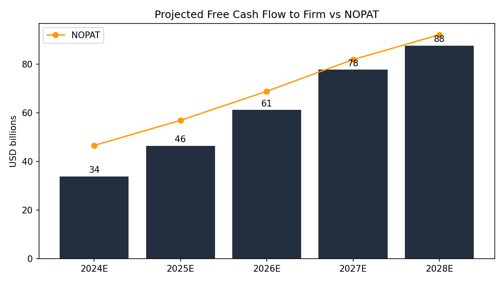
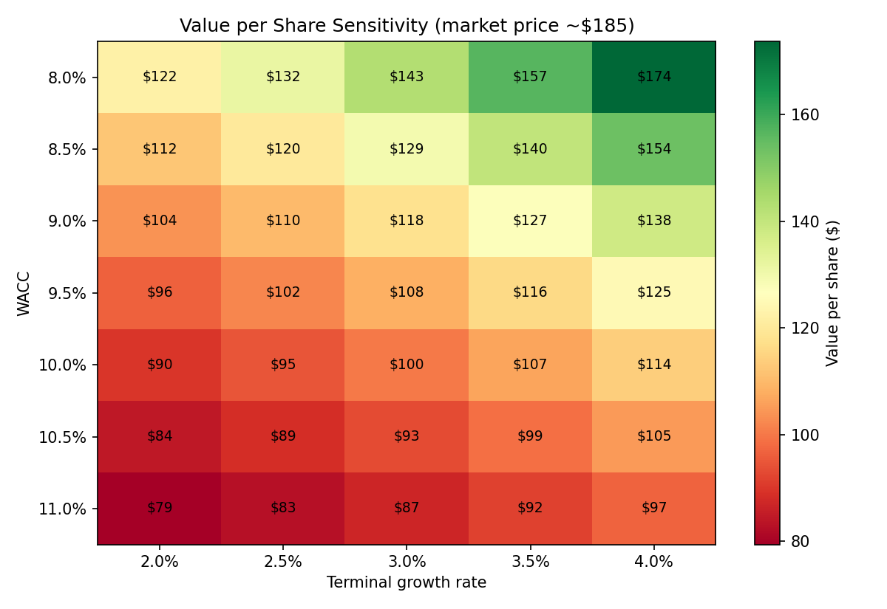

# Amazon (AMZN) Valuation Summary

Generated by `run_model.py`. Reported figures from Amazon's FY2023 Form 10-K; market inputs and projections are assumptions (see `config/assumptions.json`). USD millions unless noted.

## Result

| | |
|---|---|
| Enterprise value | $1,035.8B |
| + Cash and marketable securities | $86.8B |
| - Debt (face value) | $67.2B |
| Equity value | $1,055.4B |
| Shares outstanding (millions) | 10,383 |
| **Value per share** | **$101.65** |
| Market price (assumed) | $185.00 |
| Implied upside / (downside) | -45.1% |
| Terminal value share of EV | 78.5% |

## What the market price implies (reverse DCF)

To justify ~$185 per share with everything else held constant, the model would need either:

- a **24.4% EBIT margin in 2028** instead of the 12.5% assumed, or
- **6.5% perpetual growth** after 2028, which isn't realistic for any company long term.

Takeaway: the market is pricing in a much longer high-growth runway and a bigger margin shift (toward higher-margin businesses like AWS and advertising) than a 5-year model with a 3% terminal rate can capture. The gap is a statement about assumptions, not proof the stock is overvalued.

## WACC build

| Component | Value |
|---|---|
| Risk-free rate | 3.80% |
| Beta | 1.15 |
| Equity risk premium | 5.50% |
| Cost of equity (CAPM) | 10.12% |
| Pre-tax cost of debt (interest expense / debt) | 4.74% |
| Effective tax rate (FY2023) | 18.96% |
| After-tax cost of debt | 3.84% |
| Equity weight (market cap $1,920.9B) | 96.6% |
| Debt weight | 3.4% |
| **WACC** | **9.91%** |

## Projections

| Year   |   Revenue | Growth   |    EBIT | EBIT margin   |   NOPAT |    D&A |   Capex |   Change in NWC |   FCFF |
|:-------|----------:|:---------|--------:|:--------------|--------:|-------:|--------:|----------------:|-------:|
| 2024E  |   638,011 | 11.0%    |  57,421 | 9.0%          |  46,535 | 54,231 |  66,991 |               0 | 33,775 |
| 2025E  |   701,812 | 10.0%    |  70,181 | 10.0%         |  56,876 | 59,654 |  70,181 |               0 | 46,349 |
| 2026E  |   771,994 | 10.0%    |  84,919 | 11.0%         |  68,820 | 65,619 |  73,339 |               0 | 61,100 |
| 2027E  |   841,473 | 9.0%     | 100,977 | 12.0%         |  81,834 | 71,525 |  75,733 |               0 | 77,626 |
| 2028E  |   908,791 | 8.0%     | 113,599 | 12.5%         |  92,063 | 77,247 |  81,791 |               0 | 87,519 |

## Sensitivity: value per share

| WACC \ Terminal growth   | 2.0%   | 2.5%   | 3.0%   | 3.5%   | 4.0%   |
|:-------------------------|:-------|:-------|:-------|:-------|:-------|
| 8.0%                     | $122   | $132   | $143   | $157   | $174   |
| 8.5%                     | $112   | $120   | $129   | $140   | $154   |
| 9.0%                     | $104   | $110   | $118   | $127   | $138   |
| 9.5%                     | $96    | $102   | $108   | $116   | $125   |
| 10.0%                    | $90    | $95    | $100   | $107   | $114   |
| 10.5%                    | $84    | $89    | $93    | $99    | $105   |
| 11.0%                    | $79    | $83    | $87    | $92    | $97    |

## Credit metrics (FY2023)

| Metric | Value |
|---|---|
| EBITDA | $85.5B |
| Total debt / EBITDA | 0.79x |
| Net debt / EBITDA | -0.23x |
| EBIT / interest (interest coverage) | 11.58x |
| EBITDA / interest | 26.87x |
| DSCR (EBITDA / next-year principal + interest) | 8.06x |
| Debt / equity (book) | 0.33x |
| Debt / total capital (book) | 0.25x |

Read: Amazon holds more cash and marketable securities than debt (negative net leverage), covers interest 11.6x from operating income, and generates 8.1x the cash needed for next year's scheduled principal and interest. From a lender's view, this is a very low-risk borrower. Note: lease liabilities are excluded from debt here; including them would raise leverage meaningfully.

